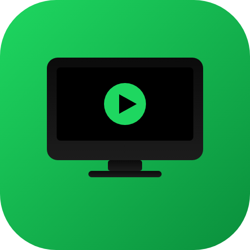

# macserver

AnyDesk처럼 **Mac 화면을 원격에서 보고 제어**하고, **지정한 폴더를 외부에서 서버처럼** 쓸 수 있게 해주는 자체 호스팅 앱입니다. Spotify의 UI/UX를 따른 어두운 테마의 데스크톱 앱 + 웹 콘솔로 구성됩니다.



## 주요 기능

- **화면 공유 및 원격 제어** — WebRTC(P2P)로 저지연 화면 스트리밍. 마우스/키보드/스크롤 원격 조작, 단축키 전송, 한글 텍스트 입력, 클립보드 동기화.
- **폴더 서버** — Mac의 특정 폴더만 골라 공유. 웹에서 업로드/다운로드(폴더는 ZIP)/미리보기/이름변경/이동/삭제. 드래그 앤 드롭, 폴더 통째 업로드 지원.
- **계정 + 폴더별 권한** — 계정마다 접근 가능한 공유 폴더(읽기 / 읽기+쓰기)와 화면 권한(보기 / 제어)을 개별 지정.
- **Mac ↔ Mac, 그리고 외부 접속** — 같은 네트워크면 주소만으로, 외부에서는 Tailscale·포트포워딩·Cloudflare Tunnel로.
- **보안** — bcrypt 비밀번호, 세션 토큰, 로그인 시도 제한/잠금, 경로 탈출 차단, 화면 접속 승인(자동/매번 묻기), 감사 로그, 선택적 HTTPS(자체 서명).

## 빠른 시작 (Mac mini에서)

```bash
cd macserver
bash scripts/setup.sh     # 의존성 설치 + 네이티브 입력 브리지 빌드 + 점검
npm start                 # 앱 실행 (트레이 상주 + 콘솔 창)
```

Finder에서 `run-macserver.command` 를 더블클릭해도 됩니다.

처음 실행하면 **설정 마법사**가 열립니다 → 관리자 계정 만들기 → 공유할 폴더 1개 선택 → 완료.

그다음 **시스템 설정 > 개인정보 보호 및 보안**에서 두 가지를 허용하세요 (앱의 *설정 > macOS 권한* 화면에서 바로 열 수 있어요):
1. **화면 및 시스템 오디오 기록** → 화면 캡처에 필요 (허용 후 앱 재실행)
2. **손쉬운 사용** → 원격 마우스/키보드 입력에 필요

> 개발 중(소스로 직접 실행)에는 권한이 **Electron** 앱에 부여됩니다. `npm run dist`로 빌드한 `macserver.app`을 쓰면 **macserver**에 부여됩니다.

## 접속하기

앱 *설정 > 접속 주소*에 표시되는 주소를 다른 Mac/기기의 브라우저에서 열고 계정으로 로그인하세요.

- 같은 Wi‑Fi/유선: `http://<Mac mini IP>:7777` 또는 `http://<이름>.local:7777`
- 외부(인터넷): **Tailscale** 추천 — 설정 > *외부에서 접속하기* 참고.

다른 Mac에도 macserver 앱을 설치했다면, 상단 **"다른 Mac에 연결"** 버튼에 주소를 넣어 바로 열 수 있어요.

## 실행 모드

| 명령 | 설명 |
|---|---|
| `npm start` | 앱 (화면 공유 + 파일 서버 + 트레이). 화면 캡처/제어 가능. |
| `npm run server` | Electron 없이 서버만. 파일 서버는 완전 동작, 화면 공유는 브라우저 `/agent` 페이지를 에이전트로 띄워야 함. |
| `npm run doctor` | 환경 점검 (Node/권한/주소). |
| `npm test` | 서버·시그널링 단위/통합 테스트. |
| `npm run dist` | `macserver.app` / `.dmg` 빌드 (electron-builder). |

## 구조

```
server/   Express API + WebSocket 시그널링 허브 (계정/공유/파일/화면 세션)
web/      웹 콘솔 SPA (Spotify 스타일) + 화면 에이전트 페이지
electron/ 데스크톱 앱: 서버 기동 + 콘솔 창 + 숨김 캡처 에이전트 + 입력 브리지
native/   Swift 입력 헬퍼 (CGEvent 로 마우스/키보드 주입) + 권한 확인
scripts/  setup / build-native / doctor
test/     단위·통합 테스트 + Playwright E2E (스크린샷 포함)
```

자세한 동작 원리는 [docs/ARCHITECTURE.md](docs/ARCHITECTURE.md), 테스트 방법은 [docs/TESTING.md](docs/TESTING.md) 를 보세요.

## 요구 사항

- macOS (화면 공유/제어). 파일 서버는 어디서든.
- Node.js 20+
- 네이티브 입력 브리지 빌드용 Xcode Command Line Tools (`xcode-select --install`)

## 라이선스

MIT
